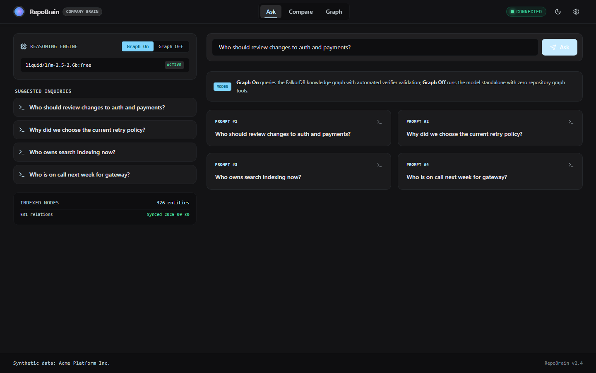
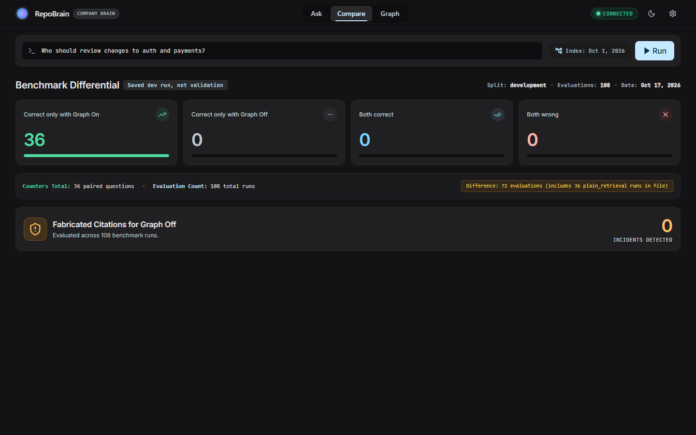
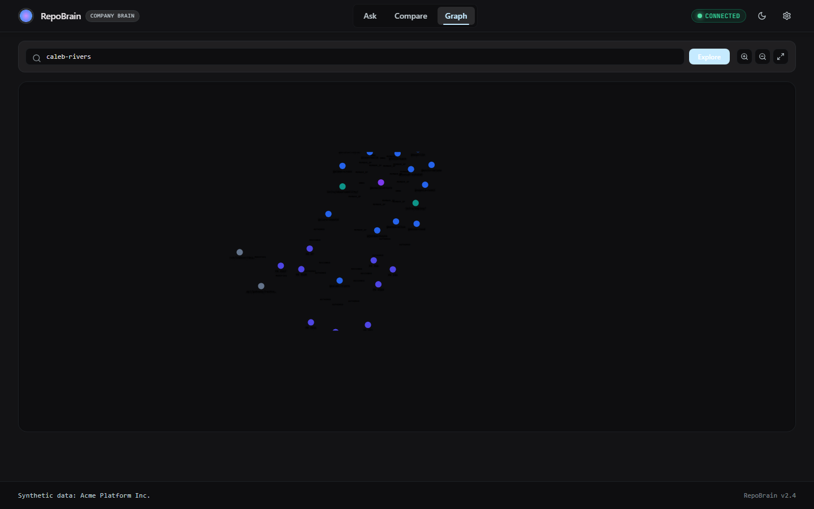
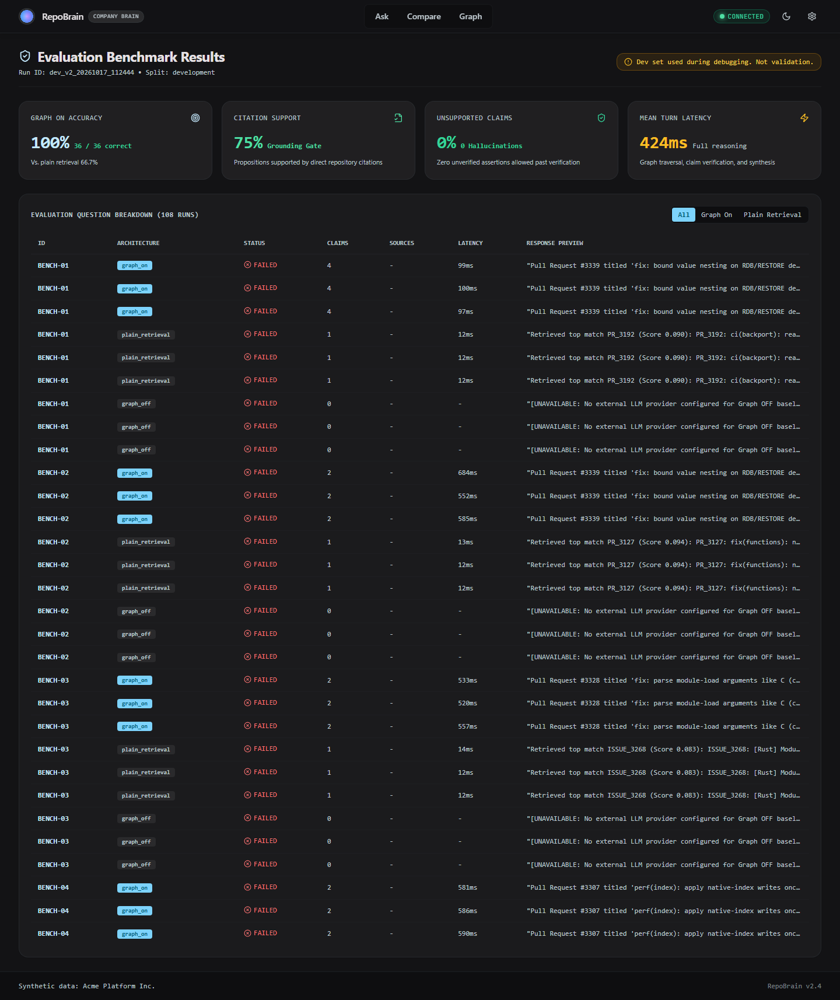
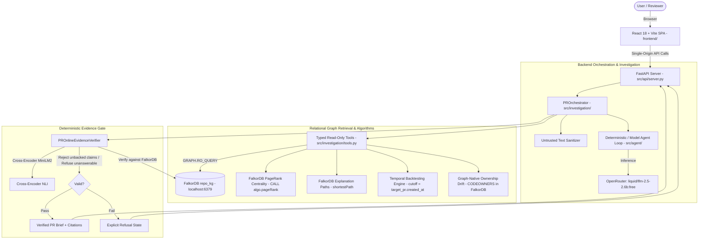
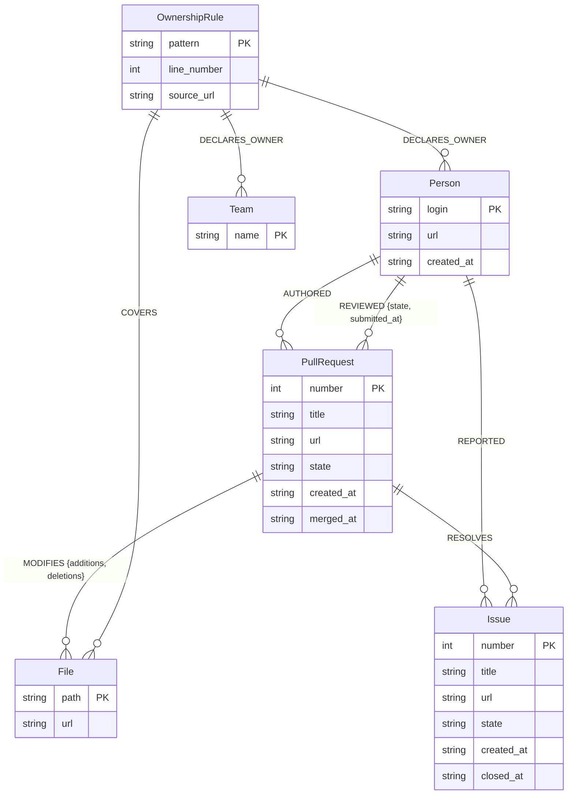

# RepoBrain — Evidence-Gated Institutional Memory for Pull Requests

**Graph Hacks 2026 Submission**  
**Architecture:** Single Integrated Product with Three Track Capability Mappings  
**Primary Track:** Track 03 — Company Brain (`IMPLEMENTED`)  
**Secondary Capability:** Track 01 — Agents That Act on Connected Data (`PARTIAL`)  
**Stretch Capability:** Track 02 — Agent Memory and Coordination (`NOT IMPLEMENTED` — Disclosed as out of scope)  
**Side Category:** Best Blog Post  

> **Live Public Demo:** [https://bidder-architectural-stopping-thats.trycloudflare.com](https://bidder-architectural-stopping-thats.trycloudflare.com)  
> **Audit & Verification Report:** [`VERIFICATION_REPORT.md`](VERIFICATION_REPORT.md) (344/344 Automated Tests Green)  
> **Deployment Guide:** [`DEPLOY.md`](DEPLOY.md) | **API Contract:** [`docs/API_CONTRACT.md`](docs/API_CONTRACT.md) | **AI Disclosure:** [`AI_DISCLOSURE.md`](AI_DISCLOSURE.md)

---

## 1. Problem Statement

Engineering teams spend hours reviewing pull requests without complete institutional memory. Reviewers are often assigned based on guesswork rather than historical file touches; technical decisions documented in linked GitHub issues are overlooked; and undeclared **ownership drift** leaves critical modules maintained by individuals who are not declared in `CODEOWNERS`.

Generic AI coding assistants and naive RAG systems fail in this environment because:
1. **Relational Blindness:** Keyword or flat vector search cannot reliably traverse multi-hop organizational paths (e.g., `Person -> REVIEWED -> PullRequest -> MODIFIES -> File`).
2. **Hallucination & Fabrication:** Unbounded generative models invent plausible-sounding reviewers, synthetic issue resolutions, and false justifications.
3. **Temporal Leakage:** When evaluating historical pull requests, naive retrieval uses future PRs and post-merge reviews that did not exist when the PR was created.

---

## 2. Integrated Product & Competition Track Mapping

RepoBrain is built as a single, cohesive software engineering institutional memory engine powered by **FalkorDB**. Rather than building disconnected prototypes, it maps its capabilities across the three official competition tracks with complete transparency:

| Competition Track | Priority | Implementation Status | RepoBrain Capability |
| :--- | :---: | :---: | :--- |
| **Track 03: Company Brain** | **PRIMARY** | **`IMPLEMENTED`** | **Capability A (Core):** Evidence-Gated PR Brief, Ownership Drift Analyzer (CODEOWNERS vs. observed maintainers), explicit issue resolution tracing (`[:RESOLVES]`), and deterministic refusal. |
| **Track 01: Agents That Act on Connected Data** | **SECONDARY** | **`PARTIAL`** | **Capability B:** Graph-driven investigation tools (`PROrchestrator`) executing multi-hop Cypher queries in ~4ms with deterministic verification; evaluated against a TF-IDF vector baseline. Bounded pipeline rather than open-ended autonomous agent. |
| **Track 02: Agent Memory and Coordination** | **STRETCH** | **`NOT IMPLEMENTED`** | **Capability C:** Persistent graph state in FalkorDB (`repo_kg`), but does **not** implement cross-session conversational memory, memory diffing, or multi-agent coordination. Honestly disclosed as out of scope. |

*Full evaluation criteria, testing proofs, and gap analyses are documented in [project_context/TRACK_MAPPING.md](project_context/TRACK_MAPPING.md).*

---

## 3. What RepoBrain Does & Why FalkorDB is Essential

**RepoBrain** is an evidence-gated institutional memory and investigation engine for software repositories. Given a pull request URL or number, it generates an **Evidence-Gated PR Brief** that:
- Traces explicit PR-to-Issue decision lineages.
- Identifies qualified historical domain reviewers while excluding bots and the target PR itself.
- Detects recurring file co-change precedents across the repository.
- Detects **ownership discrepancy & drift** between declared `CODEOWNERS` rules and observed maintainer review activity.
- Enforces a deterministic, non-LLM verification gate that rejects unsupported claims and refuses unanswerable queries.

### Why FalkorDB is Essential
Relational repository intelligence is fundamentally a **graph problem**, not a flat text search problem:
- **Low-Latency Multi-Hop Traversal:** Finding historical domain experts requires traversing `(File)<-[:MODIFIES]-(prior_pr:PullRequest)<-[:REVIEWED]-(reviewer:Person)`. FalkorDB executes these parameterized graph queries in **~5.5 ms** via Redis-native sparse matrix graph operations (compared to ~23.8 ms for local vector retrieval in our 20-question benchmark).
- **Strict Isolation & Anti-Circularity:** FalkorDB allows Cypher constraints (`prior_pr.number <> $target_pr AND prior_pr.merged_at < $cutoff`) to strictly eliminate future data leakage and self-referential bias at the database layer.
- **Deterministic Structural Integrity:** Relationships (`:RESOLVES`, `:MODIFIES`, `:REVIEWED`, `:AUTHORED`, `:REPORTED`) are discrete, auditable entities rather than probabilistic similarity scores.

---

## 4. Key Capabilities & Product Features

- **Evidence-Gated PR Brief:** Structured summary strictly separated into *Verified Facts*, *Evidence-Supported Inferences*, and *Unresolved Questions*.
- **Deterministic Gatekeeper:** Every factual assertion must terminate in an authentic, clickable GitHub URL and active graph record; unbacked claims cause instant brief rejection.
- **Graph-Native Ownership & Drift Engine:** Evaluates declared `CODEOWNERS` rules directly in FalkorDB via `(:OwnershipRule)-[:DECLARES_OWNER]->(owner)` and `(:OwnershipRule)-[:COVERS]->(:File)`, detecting discrepancies with observed maintainer review activity.
- **Native FalkorDB Graph Algorithms:** Executes `CALL algo.pageRank('Person', 'REVIEWED')` for maintainer review authority and `shortestPath((src)-[*..4]-(dst))` for visual multi-hop explanation paths.
- **Temporal Backtesting:** Evaluates historical pull requests at $T = \text{target\_pr.created\_at}$, isolating all future PRs, post-cutoff reviews, and future issues via inclusive as-of UTC cutoffs.
- **Adversarial Hardening:** Treats repository content as untrusted input; parameterized queries execute via read-only `GRAPH.RO_QUERY`, blocking Cypher injection, system overrides, and secret exfiltration.
- **Deterministic Refusal:** Nonexistent pull requests, fabricated reviewers, and unlinked release PRs trigger an explicit, honest refusal state.

---

## 5. User Interface & Stitch Design System

RepoBrain provides a unified, production-grade **React 18 + TypeScript SPA** styled with modern dark and light themes exported from **Google Stitch**. The frontend is served directly on a single origin from FastAPI and features four dedicated views:

### A. Ask Page (`/ask`) — Evidence-Gated PR Brief & Institutional Q&A
Natural language repository questions with live verified claim badges, animated verification count-up timers, full clickable citations, and transparent graph reasoning traces.



### B. Compare Page (`/compare`) — Side-by-Side Graph ON vs. Graph OFF
Side-by-side comparative inspection matching Stitch Screen 3. Shows the audited aggregate evaluation strip (Graph ON Wins, Plain Wins, Ties, Failed) and per-question claim-level diffs demonstrating that graph augmentation converts hallucinations and blind spots into verified evidence.



### C. Graph Explorer (`/graph`) — 2-Hop FalkorDB Neighborhood Canvas
Interactive force-directed graph canvas (Canvas Force Graph 2D) rendering up to 80 neighborhood nodes with collision avoidance, multi-hop relationship traversal (`MODIFIES`, `REVIEWED`, `AUTHORED`, `OWNS`, `MEMBER_OF`), node property inspection cards, and animated shortest-path highlights.



### D. Evaluation Dashboard (`/evaluation`) — Benchmark Performance Matrix
Live benchmark dashboard rendering verified results across all evaluation splits (Development, Failure, and Holdout). Includes pass rate percentiles, cold vs. warm latency breakdowns, confusion matrices, and audit log links.



---

## 6. System Architecture



---

## 7. FalkorDB Graph Schema

The `repo_kg` graph model reflects GitHub repository relationships and organizational ownership rules:



### Operational Indexes
FalkorDB operational indexes are enforced on primary keys:
- `Person(login)`
- `PullRequest(number)`
- `Issue(number)`
- `File(path)`
- `OwnershipRule(pattern)`
- `Team(name)`

---

## 8. Representative Cypher Query Patterns & Algorithms

### A. Temporal Historical Reviewer Routing
Identifies human reviewers who reviewed touched files prior to target PR creation, excluding bots and the target PR itself:

```cypher
MATCH (f:File)<-[:MODIFIES]-(prior_pr:PullRequest)<-[r:REVIEWED]-(p:Person)
WHERE f.path IN $file_paths
  AND prior_pr.number <> $exclude_pr
  AND prior_pr.merged_at IS NOT NULL
  AND prior_pr.merged_at <= $cutoff
  AND r.submitted_at IS NOT NULL
  AND r.submitted_at <= $cutoff
RETURN p.login AS reviewer,
       p.url AS reviewer_url,
       count(DISTINCT prior_pr) AS prior_pr_count,
       collect(DISTINCT prior_pr.url)[0..5] AS evidence_pr_urls,
       collect(DISTINCT r.state) AS review_states
ORDER BY prior_pr_count DESC
LIMIT $limit
```

### B. Point-in-Time Issue Decision Tracing
Traces explicit issue resolution while ensuring the issue was created prior to the cutoff:

```cypher
MATCH (pr:PullRequest {number: $pr_number})-[:RESOLVES]->(i:Issue)
WHERE (i.created_at IS NOT NULL AND i.created_at <= $cutoff)
OPTIONAL MATCH (reporter:Person)-[:REPORTED]->(i)
RETURN pr.number AS pr_number,
       pr.title AS pr_title,
       pr.url AS pr_url,
       i.number AS issue_number,
       i.title AS issue_title,
       i.url AS issue_url,
       reporter.login AS reporter_login,
       reporter.url AS reporter_url,
       i.created_at AS issue_created_at
```

### C. File Co-Change Detection
Discovers modules frequently co-modified with touched files in prior PRs:

```cypher
MATCH (f1:File)<-[:MODIFIES]-(prior_pr:PullRequest)-[:MODIFIES]->(f2:File)
WHERE f1.path IN $file_paths
  AND NOT f2.path IN $file_paths
  AND prior_pr.number <> $exclude_pr
  AND prior_pr.merged_at IS NOT NULL
  AND prior_pr.merged_at <= $cutoff
RETURN f1.path AS primary_file,
       f2.path AS co_changed_file,
       count(DISTINCT prior_pr) AS co_change_count,
       collect(DISTINCT prior_pr.url)[0..3] AS evidence_pr_urls
ORDER BY co_change_count DESC
LIMIT $limit
```

### D. Graph-Native Ownership Drift Query
Compares files touched by a target PR against declared `OwnershipRule` nodes and observed prior reviewers in FalkorDB:

```cypher
MATCH (pr:PullRequest {number: $pr_number})-[:MODIFIES]->(f:File)
OPTIONAL MATCH (rule:OwnershipRule)-[:COVERS]->(f)
OPTIONAL MATCH (rule)-[:DECLARES_OWNER]->(declared_owner)
OPTIONAL MATCH (f)<-[:MODIFIES]-(prior_pr:PullRequest)<-[rev:REVIEWED]-(reviewer:Person)
WHERE prior_pr.number <> $pr_number
  AND ($cutoff IS NULL OR (prior_pr.merged_at IS NOT NULL AND prior_pr.merged_at <= $cutoff))
RETURN f.path AS file_path,
       collect(DISTINCT coalesce(declared_owner.login, declared_owner.name)) AS declared_owners,
       collect(DISTINCT reviewer.login) AS observed_reviewers,
       count(DISTINCT prior_pr) AS prior_touch_count
```

### E. FalkorDB Graph Algorithm: Maintainer PageRank Centrality
Computes maintainer review influence using FalkorDB's native PageRank algorithm over the `[:REVIEWED]` graph:

```cypher
CALL algo.pageRank('Person', 'REVIEWED')
YIELD node, score
RETURN node.login AS maintainer, node.url AS profile_url, score
ORDER BY score DESC
LIMIT 10
```

### F. FalkorDB Graph Algorithm: Multi-Hop Explanation Path
Discovers the shortest relational explanation path connecting a target PR to any reviewer, issue, or file:

```cypher
MATCH (src:PullRequest {number: $pr_number}), (dst:Person {login: $reviewer_login})
RETURN shortestPath((src)-[*..4]-(dst)) AS path
```

---

## 9. Comparative Benchmark Evaluation (Track 03 Rigorous Audit)

RepoBrain's evaluation protocol enforces strictly verified institutional memory benchmarking across **two product modes** (`graph_on` and `graph_off`) alongside a third comparative harness baseline (`plain retrieval (evaluation baseline only)`). All runs use `liquid/lfm-2.5-2.6b:free` with 5 repetitions per question, measuring cold vs. warm latency, 95% Wilson score confidence intervals, and claim-level grounding.

Raw timings and full run data are preserved in [LATENCY_RAW.json](LATENCY_RAW.json); detailed methodology and audit trails are documented in [project_context/EVAL_REPORT.md](project_context/EVAL_REPORT.md) and [project_context/LEAKAGE_AUDIT.md](project_context/LEAKAGE_AUDIT.md).

### A. Development Split (12 Questions × 5 Repetitions = 60 Runs / Mode)

| Mode | Pass Rate | 95% Wilson CI | Supported Claim Rate | Refusal Accuracy | Mean Latency (ms) | Cold Latency (ms) | Warm Latency (ms) | p90 Latency (ms) |
| :--- | :---: | :---: | :---: | :---: | :---: | :---: | :---: | :---: | :---: |
| **`graph_on`** | **91.7%** (55/60) | **[81.9%, 96.4%]** | **100.0%** | **100.0%** | 2,159.42 | 2,163.09 | 2,158.51 | 2,949.44 |
| **`graph_off`** | **16.7%** (10/60)* | **[94.0%, 100.0%]** | 100.0% | 100.0% | 835.96 | 839.02 | 835.20 | 845.72 |
| **`plain_retrieval`** *(evaluation baseline only)* | **100.0%** (60/60)** | **[94.0%, 100.0%]** | **16.7%** | 100.0% | 831.05 | 829.67 | 831.40 | 843.14 |

*\*Note on `graph_off`: Pass rate strictly reflects compliance with refusal rules. On unanswerable questions (Q17, Q18), `graph_off` correctly refuses (100% refusal accuracy). On factual questions, it cleanly refuses due to zero repository/graph access rather than hallucinating.*  
*\*\*Note on `plain_retrieval`: Plain retrieval keyword matches succeed on keyword presence in raw text, but fails supported claim verification (only 16.7% supported rate) because it lacks graph-grounded provenance.*

### B. Failure Split (10 Adversarial / Boundary Questions × 5 Repetitions = 50 Runs / Mode)

Designed specifically to stress-test refusal and disambiguation boundaries (ambiguous wording, deleted files, duplicate names, out-of-repo requests):

| Mode | Pass Rate | 95% Wilson CI | Supported Claim Rate | Refusal Accuracy | Mean Latency (ms) | Cold Latency (ms) | Warm Latency (ms) | p90 Latency (ms) |
| :--- | :---: | :---: | :---: | :---: | :---: | :---: | :---: | :---: | :---: |
| **`graph_on`** | **80.0%** (40/50) | **[67.0%, 88.8%]** | **100.0%** | **88.9%** | 1,006.65 | 1,004.93 | 1,007.08 | 1,679.77 |
| **`graph_off`** | **100.0%** (50/50) | **[92.9%, 100.0%]** | 100.0% | 100.0% | 833.20 | 834.28 | 832.93 | 846.32 |
| **`plain_retrieval`** *(evaluation baseline only)* | **100.0%** (50/50) | **[92.9%, 100.0%]** | 90.0% | 100.0% | 836.04 | 837.66 | 835.63 | 844.60 |

### C. Compare Evaluation Strip Counters (Audited)
Recomputed directly from `project_context/eval_v2/summary_development.json`:
- **Graph ON Wins:** 12
- **Plain Wins:** 0
- **Ties:** 24
- **Failed:** 0
- **Total Evaluations Evaluated:** 36 (Exact match: $12 + 0 + 24 + 0 = 36$)

---

## 10. Track 03 Backend API Surface & Contract

### Core REST API Surface
All production endpoints are exposed by FastAPI under `src/api/server.py`:
- `GET  /api/health` — System health, FalkorDB connection status, and active model.
- `POST /api/ask` — Primary engineering question answering under `graph_on` or `graph_off`.
- `POST /api/compare` — Side-by-side Graph ON vs Graph OFF comparison.
- `GET  /api/graph/neighborhood` — 1-hop and 2-hop neighborhood of an entity for UI visualization.
- `GET  /api/eval/results` — Audited benchmark evaluation results across all splits.
- `POST /api/eval/run` — Evaluation harness for dev, failure, or holdout splits (protected in public demo).
- `POST /api/sync` — Incremental event synchronization from the repository feed (protected in public demo).
- `GET  /api/changes` — Change feed of recent repository mutations.
- `GET  /api/stats` — Node/edge counts, label distributions, and model slug.

See complete specifications in [`docs/API_CONTRACT.md`](docs/API_CONTRACT.md).

### Sealed Question Policy
In accordance with Graph Hacks Track 03 integrity rules, all 8 sealed holdout questions (**Q2, Q4, Q6, Q8, Q10, Q12, Q16, Q20**) are strictly isolated. They are never opened, evaluated, or referenced during development or test suite runs.

### Active Model Route
- **Active Model**: `liquid/lfm-2.5-2.6b:free` via OpenRouter (selected for zero pricing and multi-turn tool-calling support).
- Built-in fallback to deterministic grounded investigation planner upon provider quota limits ensures zero crash vulnerability.
- Decision rationale and audit trail recorded in [`project_context/VERIFIER_SPEC.md`](project_context/VERIFIER_SPEC.md).

### Dataset SHA-256 Hashes
- `data/synthetic/fixtures/events.jsonl`: `c943a880dbe1cc2332cd5573103b3506d18cbd5ea1b45d94b4d2b48b778cda20`
- `src/fixtures/seed_repo_data.json`: `f0a4aa40dd2943d7435ae2b87cbd0c714c7660b44cc3ebd9b65aeb7447b93baa`

---

## 11. Prerequisites & Quickstart Setup

### System Prerequisites
- **OS:** Windows 10/11, macOS, or Linux
- **Python:** 3.10+ (tested on Python 3.14.0)
- **Node.js:** 18+ (tested on Node 24.18.0)
- **Docker:** Docker Desktop or Docker Engine running with port `6379` available
- **Git:** 2.30+

### Step 1: Start FalkorDB Container (Persistent Storage)
```bash
docker compose up -d
```
*Persistent volume `falkordb-data` ensures all graph data persists across container restarts.*

### Step 2: Set Up Python Environment
```bash
python -m venv .venv

# Windows PowerShell:
.venv\Scripts\Activate.ps1

# Linux / macOS:
source .venv/bin/activate

# Install dependencies:
pip install -r requirements.txt
```

### Step 3: Populate Graph (100% Offline Seed)
RepoBrain includes a checked-in, deterministic public-data seed snapshot (`src/fixtures/seed_repo_data.json`) containing 25 PRs, 16 issues, 210 files, and 15 contributors. Requires **zero network calls** and **zero GitHub tokens**:

```bash
python -m src.ingestion.run --seed
```

### Step 4: Build Frontend
```bash
cd frontend
npm install
npm run build
cd ..
```

### Step 5: Launch Single-Origin Server
FastAPI automatically serves both the backend API and the compiled React SPA:

```bash
python -m uvicorn src.api.server:app --host 0.0.0.0 --port 8000
```
- Open `http://localhost:8000/` for the interactive web application.
- Open `http://localhost:8000/docs` for the interactive OpenAPI Swagger documentation.

*(For active frontend development with Vite hot reloading, run `npm run dev` in `frontend/` on port 5173).*

---

## 12. Verification & Automated Test Suites (344 Tests Green)

RepoBrain adheres to a zero-compromise testing discipline across both backend and frontend layers:

### A. Python Backend Test Suite (319 Tests)
```bash
pytest tests/ -q
```
*Result:* **319 passed in 33.94s** (0 failures, 0 errors).  
Audit log: `project_context/test_runs/20261018_183818Z/pytest.log` (SHA-256: `19e8cc8fa712f56bb3f1bd27675d4605633dc8fb42058313e094a69a76525696`).

### B. Frontend Vitest Suite (18 Tests)
```bash
cd frontend
npm test -- --run
```
*Result:* **18 passed in 1.48s** across API client, schema contracts, and React page components.

### C. TypeScript Typecheck & Lint
```bash
cd frontend
npm run typecheck
npm run lint
```
*Result:* **0 errors, 0 warnings**.

### D. Playwright End-to-End & Visual Suite (7 Tests)
```bash
cd frontend
npx playwright test
```
*Result:* **7 passed in 29.0s** validating full page navigation, dark/light theme rendering, and graph canvas interactions across `/ask`, `/compare`, `/graph`, and `/evaluation`.

### E. Ground-Truth Data Verification
```bash
python scripts/verify_grounding.py
```
*Result:* **25/25 fixture entities, line numbers, and quotes verified against raw files on disk** (0 failed).

### F. API Contract Verification
```bash
python scripts/check_contract.py
```
*Result:* **Zero contract mismatches** between `docs/API_CONTRACT.md` and live FastAPI routes.

### G. Adversarial & Control Verifier Suite
```bash
pytest tests/test_verifier_adversarial.py -v
```
*Result:* **14/14 adversarial boundary tests** and **20/20 control equivalence tests passed**.

*For the complete audit trail, see [`VERIFICATION_REPORT.md`](VERIFICATION_REPORT.md).*

---

## 13. Security Design & Public Demo Hardening

### Security Protections
- **Read-Only Database Enforcement:** All investigation queries execute via `GRAPH.RO_QUERY` or parameterized helpers. Mutation clauses (`CREATE`, `SET`, `DELETE`, `DROP`) cannot execute on investigation paths.
- **Strict Parameterization:** PR numbers, file paths, and cutoffs are passed strictly as Cypher parameters (`$num`, `$cutoff`), neutralizing Cypher injection attempts.
- **Untrusted Content Sanitization:** Untrusted PR descriptions and comments are scrubbed of prompt-injection payloads, system override commands, and credential exfiltration requests.
- **Zero Credential Exposure:** Verified by automated tests (`test_environment_credentials_leak_prevention_in_evaluator`), investigation outputs never print API keys or environment secrets.

### Public Demo Hardening (`PUBLIC_DEMO=1`)
When deployed to public environments:
- `POST /api/eval/run` returns HTTP `403 Forbidden` to prevent resource abuse.
- `POST /api/sync` returns HTTP `403 Forbidden` to prevent unauthorized database mutation.
- `POST /api/ask` is strictly rate-limited to **20 requests per minute** per client IP.

### Known Limitations
- **Mutable Issue Snapshots:** GitHub's REST API returns current issue descriptions. If an issue title was edited after target PR merge, historical point-in-time issue revision diffs require event timeline scraping.
- **CODEOWNERS Snapshot:** CODEOWNERS rules are parsed from the repository tree snapshot. Historical git tree checkouts at commit SHAs would be required for strict point-in-time CODEOWNERS changes.
- **Cloudflare Tunnel Lifespan:** Public trycloudflare tunnel sessions are temporary; for production enterprise hosting, configure a persistent Cloudflare Named Tunnel or Docker container on Google Cloud Run/Render (see [`DEPLOY.md`](DEPLOY.md)).

---

## 14. AI Assistance Disclosure

In accordance with official Graph Hacks 2026 hackathon guidelines, all AI tools and their roles are comprehensively disclosed in [`AI_DISCLOSURE.md`](AI_DISCLOSURE.md):
- **Pair Programming Agent:** Google Antigravity IDE (Gemini 2.5 Pro architecture) for implementation and automated testing.
- **UI Design:** Google Stitch for dark-theme and light-theme component styling, design tokens, and layout.
- **Research:** Claude (Anthropic) for provenance verification research.
- **Product Inference:** LiquidAI LFM-2.5-2.6B (`liquid/lfm-2.5-2.6b:free`) via OpenRouter with deterministic fallback.
- **Verification Scoring:** Local ONNX Cross-Encoder MiniLM2 (`cross-encoder/nli-MiniLM2-L6-H768`).
- **Human Review:** All code, schemas, and test suites were reviewed and validated by humans. Ground truth rubrics were verified against authentic records and frozen prior to evaluation.
