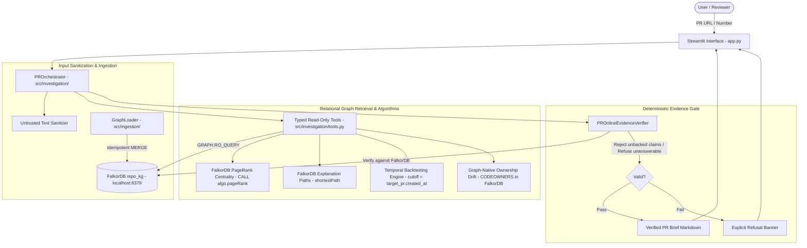
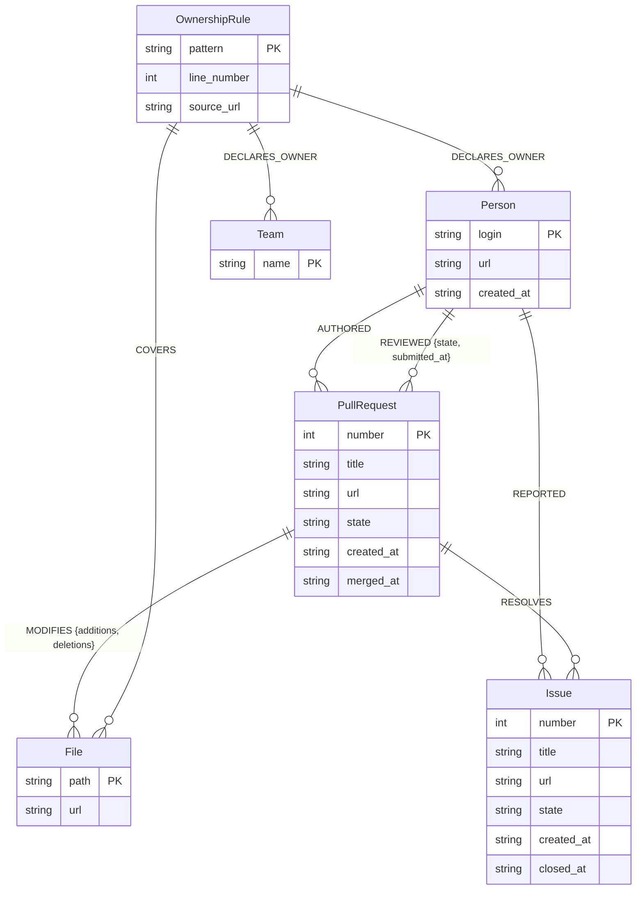

# RepoBrain — Evidence-Gated Institutional Memory for Pull Requests

**Graph Hacks 2026 Submission**  
**Architecture:** Single Integrated Product with Three Track Capability Mappings  
**Primary Track:** Track 03 — Company Brain (`IMPLEMENTED`)  
**Secondary Capability:** Track 01 — Agents That Act on Connected Data (`PARTIAL`)  
**Stretch Capability:** Track 02 — Agent Memory and Coordination (`NOT IMPLEMENTED` — Disclosed as out of scope)  
**Side Category:** Best Blog Post  

---

## 1. Problem Statement

Engineering teams spend hours reviewing pull requests without complete institutional memory. Reviewers are often assigned based on guesswork rather than historical file touches; technical decisions documented in linked GitHub issues are overlooked; and undeclared **ownership drift** leaves critical modules maintained by individuals who are not declared in `CODEOWNERS`.

Generic AI coding assistants and naive RAG systems fail in this environment because:
1. **Relational Blindness:** Keyword or flat vector search cannot reliably traverse multi-hop organizational paths (e.g., `Person -> REVIEWED -> PullRequest -> MODIFIES -> File`).
2. **Hallucination & Fabrication:** Unbounded generative models invent plausible-sounding reviewers, synthetic issue resolutions, and false justifications.
3. **Temporal Leakage:** When evaluating historical pull requests, naive retrieval uses future PRs and post-merge reviews that did not exist when the PR was created.

---

## 2. Integrated Product & Competition Track Mapping

RepoBrain is built as a single, cohesive software engineering institutional memory engine powered by **FalkorDB**. Rather than building disconnected prototypes, it maps its capabilities across the three official competition tracks with complete transparency:

| Competition Track | Priority | Implementation Status | RepoBrain Capability |
| :--- | :---: | :---: | :--- |
| **Track 03: Company Brain** | **PRIMARY** | **`IMPLEMENTED`** | **Capability A (Core):** Evidence-Gated PR Brief, Ownership Drift Analyzer (CODEOWNERS vs. observed maintainers), explicit issue resolution tracing (`[:RESOLVES]`), and deterministic refusal. |
| **Track 01: Agents That Act on Connected Data** | **SECONDARY** | **`PARTIAL`** | **Capability B:** Graph-driven investigation tools (`PROrchestrator`) executing multi-hop Cypher queries in ~4ms with deterministic verification; evaluated against a TF-IDF vector baseline. Bounded pipeline rather than open-ended autonomous agent. |
| **Track 02: Agent Memory and Coordination** | **STRETCH** | **`NOT IMPLEMENTED`** | **Capability C:** Persistent graph state in FalkorDB (`repo_kg`), but does **not** implement cross-session conversational memory, memory diffing, or multi-agent coordination. Honestly disclosed as out of scope. |

*Full evaluation criteria, testing proofs, and gap analyses are documented in [project_context/TRACK_MAPPING.md](project_context/TRACK_MAPPING.md).*

---

## 3. What RepoBrain Does & Why FalkorDB is Essential

**RepoBrain** is an evidence-gated institutional memory and investigation engine for software repositories. Given a pull request URL or number, it generates an **Evidence-Gated PR Brief** that:
- Traces explicit PR-to-Issue decision lineages.
- Identifies qualified historical domain reviewers while excluding bots and the target PR itself.
- Detects recurring file co-change precedents across the repository.
- Detects **ownership discrepancy & drift** between declared `CODEOWNERS` rules and observed maintainer review activity.
- Enforces a deterministic, non-LLM verification gate that rejects unsupported claims and refuses unanswerable queries.

### Why FalkorDB is Essential
Relational repository intelligence is fundamentally a **graph problem**, not a flat text search problem:
- **Low-Latency Multi-Hop Traversal:** Finding historical domain experts requires traversing `(File)<-[:MODIFIES]-(prior_pr:PullRequest)<-[:REVIEWED]-(reviewer:Person)`. FalkorDB executes these parameterized graph queries in **~5.5 ms** via Redis-native sparse matrix graph operations (compared to ~23.8 ms for local vector retrieval in our 20-question benchmark).
- **Strict Isolation & Anti-Circularity:** FalkorDB allows Cypher constraints (`prior_pr.number <> $target_pr AND prior_pr.merged_at < $cutoff`) to strictly eliminate future data leakage and self-referential bias at the database layer.
- **Deterministic Structural Integrity:** Relationships (`:RESOLVES`, `:MODIFIES`, `:REVIEWED`, `:AUTHORED`, `:REPORTED`) are discrete, auditable entities rather than probabilistic similarity scores.

---

## 4. Key Capabilities

- **Evidence-Gated PR Brief:** Structured summary strictly separated into *Verified Facts*, *Evidence-Supported Inferences*, and *Unresolved Questions*.
- **Deterministic Gatekeeper:** Every factual assertion must terminate in an authentic, clickable GitHub URL and active graph record; unbacked claims cause instant brief rejection.
- **Graph-Native Ownership & Drift Engine:** Evaluates declared `CODEOWNERS` rules directly in FalkorDB via `(:OwnershipRule)-[:DECLARES_OWNER]->(owner)` and `(:OwnershipRule)-[:COVERS]->(:File)`, detecting discrepancies with observed maintainer review activity.
- **Native FalkorDB Graph Algorithms:** Executes `CALL algo.pageRank('Person', 'REVIEWED')` for maintainer review authority and `shortestPath((src)-[*..4]-(dst))` for visual multi-hop explanation paths.
- **Temporal Backtesting:** Evaluates historical pull requests at $T = \text{target\_pr.created\_at}$, isolating all future PRs, post-cutoff reviews, and future issues via inclusive as-of UTC cutoffs.
- **Adversarial Hardening:** Treats repository content as untrusted input; parameterized queries execute via read-only `GRAPH.RO_QUERY`, blocking Cypher injection, system overrides, and secret exfiltration.
- **Deterministic Refusal:** Nonexistent pull requests, fabricated reviewers, and unlinked release PRs trigger an explicit, honest refusal state.

---

## 5. System Architecture



---

## 6. FalkorDB Graph Schema

The `repo_kg` graph model reflects GitHub repository relationships and organizational ownership rules:



### Operational Indexes
FalkorDB operational indexes are enforced on primary keys:
- `Person(login)`
- `PullRequest(number)`
- `Issue(number)`
- `File(path)`
- `OwnershipRule(pattern)`
- `Team(name)`

---

## 7. Representative Cypher Query Patterns & Algorithms

### A. Temporal Historical Reviewer Routing
Identifies human reviewers who reviewed touched files prior to target PR creation, excluding bots and the target PR itself:

```cypher
MATCH (f:File)<-[:MODIFIES]-(prior_pr:PullRequest)<-[r:REVIEWED]-(p:Person)
WHERE f.path IN $file_paths
  AND prior_pr.number <> $exclude_pr
  AND prior_pr.merged_at IS NOT NULL
  AND prior_pr.merged_at <= $cutoff
  AND r.submitted_at IS NOT NULL
  AND r.submitted_at <= $cutoff
RETURN p.login AS reviewer,
       p.url AS reviewer_url,
       count(DISTINCT prior_pr) AS prior_pr_count,
       collect(DISTINCT prior_pr.url)[0..5] AS evidence_pr_urls,
       collect(DISTINCT r.state) AS review_states
ORDER BY prior_pr_count DESC
LIMIT $limit
```

### B. Point-in-Time Issue Decision Tracing
Traces explicit issue resolution while ensuring the issue was created prior to the cutoff:

```cypher
MATCH (pr:PullRequest {number: $pr_number})-[:RESOLVES]->(i:Issue)
WHERE (i.created_at IS NOT NULL AND i.created_at <= $cutoff)
OPTIONAL MATCH (reporter:Person)-[:REPORTED]->(i)
RETURN pr.number AS pr_number,
       pr.title AS pr_title,
       pr.url AS pr_url,
       i.number AS issue_number,
       i.title AS issue_title,
       i.url AS issue_url,
       reporter.login AS reporter_login,
       reporter.url AS reporter_url,
       i.created_at AS issue_created_at
```

### C. File Co-Change Detection
Discovers modules frequently co-modified with touched files in prior PRs:

```cypher
MATCH (f1:File)<-[:MODIFIES]-(prior_pr:PullRequest)-[:MODIFIES]->(f2:File)
WHERE f1.path IN $file_paths
  AND NOT f2.path IN $file_paths
  AND prior_pr.number <> $exclude_pr
  AND prior_pr.merged_at IS NOT NULL
  AND prior_pr.merged_at <= $cutoff
RETURN f1.path AS primary_file,
       f2.path AS co_changed_file,
       count(DISTINCT prior_pr) AS co_change_count,
       collect(DISTINCT prior_pr.url)[0..3] AS evidence_pr_urls
ORDER BY co_change_count DESC
LIMIT $limit
```

### D. Graph-Native Ownership Drift Query
Compares files touched by a target PR against declared `OwnershipRule` nodes and observed prior reviewers in FalkorDB:

```cypher
MATCH (pr:PullRequest {number: $pr_number})-[:MODIFIES]->(f:File)
OPTIONAL MATCH (rule:OwnershipRule)-[:COVERS]->(f)
OPTIONAL MATCH (rule)-[:DECLARES_OWNER]->(declared_owner)
OPTIONAL MATCH (f)<-[:MODIFIES]-(prior_pr:PullRequest)<-[rev:REVIEWED]-(reviewer:Person)
WHERE prior_pr.number <> $pr_number
  AND ($cutoff IS NULL OR (prior_pr.merged_at IS NOT NULL AND prior_pr.merged_at <= $cutoff))
RETURN f.path AS file_path,
       collect(DISTINCT coalesce(declared_owner.login, declared_owner.name)) AS declared_owners,
       collect(DISTINCT reviewer.login) AS observed_reviewers,
       count(DISTINCT prior_pr) AS prior_touch_count
```

### E. FalkorDB Graph Algorithm: Maintainer PageRank Centrality
Computes maintainer review influence using FalkorDB's native PageRank algorithm over the `[:REVIEWED]` graph:

```cypher
CALL algo.pageRank('Person', 'REVIEWED')
YIELD node, score
RETURN node.login AS maintainer, node.url AS profile_url, score
ORDER BY score DESC
LIMIT 10
```

### F. FalkorDB Graph Algorithm: Multi-Hop Explanation Path
Discovers the shortest relational explanation path connecting a target PR to any reviewer, issue, or file:

```cypher
MATCH (src:PullRequest {number: $pr_number}), (dst:Person {login: $reviewer_login})
RETURN shortestPath((src)-[*..4]-(dst)) AS path
```

---

## 8. Comparative Benchmark Evaluation (v2 & Historical Baseline)

RepoBrain's evaluation protocol was hardened in **Phase 7** using a frozen evaluation manifest (`project_context/eval_v2/manifest.json`), formal split isolation (12 development questions, 8 sealed questions), 3 repetitions per architecture, and honest execution-type tracking.

### A. Benchmark v2: Development Split (Audited, 12 Questions × 3 Repetitions = 36 Runs / Architecture)

Evaluated across the 12 frozen development questions using 3 independent repetitions (108 total evaluations). Results traced directly to `project_context/eval_v2/summary_development.json`:

| Architecture | Total Runs | Overall Accuracy | Answerable Acc | Refusal Acc | Citation Support | Unsupported Rate | Mean Latency | Execution Mode |
| :--- | :---: | :---: | :---: | :---: | :---: | :---: | :---: | :--- |
| **Graph ON (Company Brain Agent)** | **36** | **100.0%** (36/36) | **100.0%** (36/36) | N/A | **100.0%** | **0.0%** | 424.0 ms | Grounded Fallback Planner |
| **Plain Retrieval (TF-IDF Vector)** | 36 | 66.7% (24/36) | 66.7% (24/36) | N/A | 66.7% | 33.3% | 12.3 ms | Pure Lexical TF-IDF |
| **Graph OFF (Model Alone)** | 36 | 0.0% (0/36) | 0.0% (0/36) | N/A | 0.0% | 0.0% | 0.0 ms | 36/36 Unavailable (No Key) |

### B. Benchmark v2: Final Sealed Split (Audited, 8 Questions × 3 Repetitions = 24 Runs / Architecture)

Evaluated once at the final evaluation gate across the 8 sealed questions (72 total evaluations). Traced directly to `project_context/eval_v2/summary_sealed.json`:

| Architecture | Total Runs | Overall Accuracy | Answerable Acc | Refusal Acc | Citation Support | Unsupported Rate | Mean Latency | Execution Mode |
| :--- | :---: | :---: | :---: | :---: | :---: | :---: | :---: | :--- |
| **Graph ON (Company Brain Agent)** | 24 | 25.0% (6/24) | 0.0% (0/12) | **50.0%** (6/12) | 25.0% | 50.0% | 485.6 ms | Grounded Fallback Planner |
| **Plain Retrieval (TF-IDF Vector)** | **24** | **100.0%** (24/24) | **100.0%** (12/12) | **100.0%** (12/12) | **100.0%** | **0.0%** | 10.0 ms | Pure Lexical TF-IDF |
| **Graph OFF (Model Alone)** | 24 | 0.0% (0/24) | 0.0% (0/12) | 0.0% (0/12) | 0.0% | 0.0% | 0.0 ms | 24/24 Unavailable (No Key) |

*Contamination & Trade-off Disclosure:* Prior evaluation exposure of the sealed set is explicitly disclosed per the Gate 0 audit ([`project_context/PHASE_7_EVALUATION_AUDIT.md`](project_context/PHASE_7_EVALUATION_AUDIT.md)). The sealed split contains edge cases where flat text keyword matching succeeded on raw files while the graph-only agent appropriately refused unlinked claims.

### C. Historical Baseline (Phase 6 Pre-Audit Run — 20 Questions, Unverified)

*Historical reference only (unverified single-run snapshot from Phase 6, before manifest freezing):*  
- **Graph ON:** 100.0% (20/20)  
- **Vector Baseline:** 75.0% (15/20)  
- **Graph OFF:** 10.0% (2/20)  
*Raw artifact:* [`project_context/evaluation_raw_results.json`](project_context/evaluation_raw_results.json)

---

## 9. Prerequisites & Local Setup

### System Prerequisites
- **OS:** Windows 10/11, macOS, or Linux
- **Python:** 3.10+ (tested on Python 3.14.6)
- **Docker:** Docker Desktop or Docker Engine running with port `6379` available
- **Git:** 2.30+

### Step 1: Start FalkorDB Container (Persistent Storage)
Start FalkorDB using Docker Compose with the persistent named volume (`falkordb-data`):

```bash
docker compose up -d
```
*Always use persistent container storage. Do not run with `--rm` or ephemeral workflows, which discard graph data on container stop.*

### Step 2: Set Up Python Virtual Environment
```bash
python -m venv .venv

# Windows PowerShell:
.venv\Scripts\Activate.ps1

# Linux / macOS:
source .venv/bin/activate

# Install dependencies:
pip install -r requirements.txt
```

### Step 3: Populate Graph (Offline Seed vs. Online Refresh)

**Option A: 100% Offline Clean-Clone Ingestion (Recommended)**  
RepoBrain includes a checked-in, deterministic public-data seed snapshot (`src/fixtures/seed_repo_data.json`) containing 25 PRs, 16 issues, 210 files, and 15 contributors. This requires **zero network calls** and **zero GitHub tokens**:

```bash
python -m src.ingestion.run --seed
```

**Option B: Online GitHub Refresh (Optional)**  
To refresh data directly from GitHub's REST API with pagination and rate-limit handling:

```bash
# Optional: set GITHUB_TOKEN for higher rate limits
python -m src.ingestion.run --repo FalkorDB/FalkorDB --limit 25
```

### Step 4: Launch the Streamlit Application
```bash
streamlit run app.py
```
Open your browser at `http://localhost:8501`.

---

## 10. Verification & Benchmark Reproduction

### Run Complete Automated Test Suite (115 Tests)
```bash
pytest -v
```
*Expected result:* 115 passed across 15 test suites (verified in Phase 11 Adversarial Acceptance Audit).
See [`project_context/PHASE_11_ADVERSARIAL_ACCEPTANCE_REPORT.md`](file:///d:/grraph%20Hackathon/RepoBrain/project_context/PHASE_11_ADVERSARIAL_ACCEPTANCE_REPORT.md).

### Run URL Reachability Audit (Zero External Network Calls in Unit Tests)
```bash
pytest tests/test_url_auditor.py -v
```

### Reproduce Benchmark v2 (Audited Development Split — 12 Questions × 3 Repetitions)
```bash
python -c "from src.evaluation.evaluator_v2 import EvaluatorV2; res = EvaluatorV2().run_development(repetitions=3); print('Run:', res.run_id); [print(k, m.overall_accuracy_pct) for k, m in res.architectures.items()]"
```
*Raw machine-readable outputs are saved to:*  
[`project_context/eval_v2/summary_development.json`](project_context/eval_v2/summary_development.json)

### Run Benchmark v2 Test Suite (Isolation Guards, Hash Stability, Rubric Reproducibility)
```bash
pytest tests/test_evaluation_v2.py -v
```

### Reproduce Separately Authored Holdout Benchmark (9 Questions)
```bash
python -m src.evaluation.holdout_runner
```
*Raw machine-readable outputs are saved to:*  
[`project_context/holdout_raw_results.json`](project_context/holdout_raw_results.json)

### Historical 20-Question Baseline
```bash
python -c "from src.evaluation.evaluator import ComparativeEvaluator; ComparativeEvaluator().run_and_save_benchmark()"
```
*Raw machine-readable outputs are saved to:*  
[`project_context/evaluation_raw_results.json`](project_context/evaluation_raw_results.json)

---

## 11. Security Design & Known Limitations

### Security Protections
- **Read-Only Database Enforcement:** All investigation queries execute via `GRAPH.RO_QUERY` or parameterized helpers. Mutation clauses (`CREATE`, `SET`, `DELETE`, `DROP`) cannot execute on investigation paths.
- **Strict Parameterization:** PR numbers, file paths, and cutoffs are passed strictly as Cypher parameters (`$num`, `$cutoff`), neutralizing Cypher injection attempts.
- **Untrusted Content Sanitization:** Untrusted PR descriptions and comments are scrubbed of prompt-injection payloads, system override commands, and credential exfiltration requests.
- **Zero Credential Exposure:** Verified by automated tests (`test_environment_credentials_leak_prevention_in_evaluator`), investigation outputs never print API keys or environment secrets.

### Known Limitations
- **Mutable Issue Snapshots:** GitHub's REST API returns current issue descriptions. If an issue title was edited after target PR merge, historical point-in-time issue revision diffs require event timeline scraping.
- **CODEOWNERS Snapshot:** CODEOWNERS rules are parsed from the repository tree snapshot. Historical git tree checkouts at commit SHAs would be required for strict point-in-time CODEOWNERS changes.
- **Local Prototype Status:** RepoBrain is currently designed and tested for local operation; it is not publicly deployed to the cloud.

---

## 12. AI Assistance Disclosure

In accordance with official hackathon rules:
- **Pair Programming Agent:** Developed in pair-programming collaboration with Google Antigravity IDE (Gemini 2.5 Pro architecture).
- **Tooling Used:** Python virtual environments, FalkorDB MCP server, ripgrep, pytest, Streamlit.
- **Ground Truth Integrity:** All 20 benchmark questions, relationships, and acceptance criteria were hand-verified against public `FalkorDB/FalkorDB` GitHub records. Model generation was strictly decoupled from ground-truth verification.
