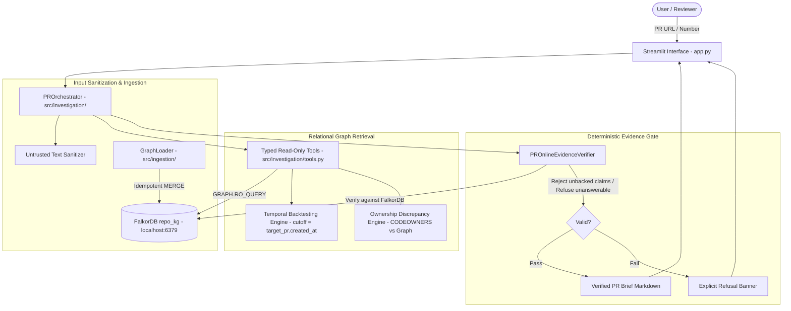
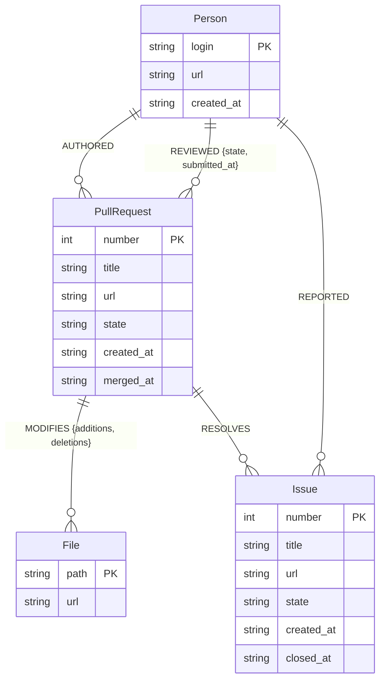

# RepoBrain — Evidence-Gated Institutional Memory for Pull Requests

**Graph Hacks 2026 Submission**  
**Architecture:** Single Integrated Product with Three Track Capability Mappings  
**Primary Track:** Track 03 — Company Brain (`IMPLEMENTED`)  
**Secondary Capability:** Track 01 — Agents That Act on Connected Data (`PARTIAL`)  
**Stretch Capability:** Track 02 — Agent Memory and Coordination (`NOT IMPLEMENTED` — Disclosed as out of scope)  
**Side Category:** Best Blog Post  

---

## 1. Problem Statement

Engineering teams spend hours reviewing pull requests without complete institutional memory. Reviewers are often assigned based on guesswork rather than historical file touches; technical decisions documented in linked GitHub issues are overlooked; and undeclared **ownership drift** leaves critical modules maintained by individuals who are not declared in `CODEOWNERS`.

Generic AI coding assistants and naive RAG systems fail in this environment because:
1. **Relational Blindness:** Keyword or flat vector search cannot reliably traverse multi-hop organizational paths (e.g., `Person -> REVIEWED -> PullRequest -> MODIFIES -> File`).
2. **Hallucination & Fabrication:** Unbounded generative models invent plausible-sounding reviewers, synthetic issue resolutions, and false justifications.
3. **Temporal Leakage:** When evaluating historical pull requests, naive retrieval uses future PRs and post-merge reviews that did not exist when the PR was created.

---

## 2. Integrated Product & Competition Track Mapping

RepoBrain is built as a single, cohesive software engineering institutional memory engine powered by **FalkorDB**. Rather than building disconnected prototypes, it maps its capabilities across the three official competition tracks with complete transparency:

| Competition Track | Priority | Implementation Status | RepoBrain Capability |
| :--- | :---: | :---: | :--- |
| **Track 03: Company Brain** | **PRIMARY** | **`IMPLEMENTED`** | **Capability A (Core):** Evidence-Gated PR Brief, Ownership Drift Analyzer (CODEOWNERS vs. observed maintainers), explicit issue resolution tracing (`[:RESOLVES]`), and deterministic refusal. |
| **Track 01: Agents That Act on Connected Data** | **SECONDARY** | **`PARTIAL`** | **Capability B:** Graph-driven investigation tools (`PROrchestrator`) executing multi-hop Cypher queries in ~4ms with deterministic verification; evaluated against a TF-IDF vector baseline. Bounded pipeline rather than open-ended autonomous agent. |
| **Track 02: Agent Memory and Coordination** | **STRETCH** | **`NOT IMPLEMENTED`** | **Capability C:** Persistent graph state in FalkorDB (`repo_kg`), but does **not** implement cross-session conversational memory, memory diffing, or multi-agent coordination. Honestly disclosed as out of scope. |

*Full evaluation criteria, testing proofs, and gap analyses are documented in [project_context/TRACK_MAPPING.md](project_context/TRACK_MAPPING.md).*

---

## 3. What RepoBrain Does & Why FalkorDB is Essential

**RepoBrain** is an autonomous institutional intelligence engine for software repositories. Given a pull request URL or number, it generates an **Evidence-Gated PR Brief** that:
- Traces explicit PR-to-Issue decision lineages.
- Identifies qualified historical domain reviewers while excluding bots and the target PR itself.
- Detects recurring file co-change precedents across the repository.
- Detects **ownership discrepancy & drift** between declared `CODEOWNERS` rules and observed maintainer review activity.
- Enforces a deterministic, non-LLM verification gate that rejects unsupported claims and refuses unanswerable queries.

### Why FalkorDB is Essential
Relational repository intelligence is fundamentally a **graph problem**, not a flat text search problem:
- **Low-Latency Multi-Hop Traversal:** Finding historical domain experts requires traversing `(File)<-[:MODIFIES]-(prior_pr:PullRequest)<-[:REVIEWED]-(reviewer:Person)`. FalkorDB executes these parameterized graph queries in **~4.0 ms** via Redis-native sparse matrix graph operations—**3.6x faster** than local vector retrieval.
- **Strict Isolation & Anti-Circularity:** FalkorDB allows Cypher constraints (`prior_pr.number <> $target_pr AND prior_pr.merged_at < $cutoff`) to strictly eliminate future data leakage and self-referential bias at the database layer.
- **Deterministic Structural Integrity:** Relationships (`:RESOLVES`, `:MODIFIES`, `:REVIEWED`, `:AUTHORED`, `:REPORTED`) are discrete, auditable entities rather than probabilistic similarity scores.

---

## 4. Key Capabilities

- **Evidence-Gated PR Brief:** Structured summary strictly separated into *Verified Facts*, *Evidence-Supported Inferences*, and *Unresolved Questions*.
- **Deterministic Gatekeeper:** Every factual assertion must terminate in an authentic, clickable GitHub URL and active graph record; unbacked claims cause instant brief rejection.
- **Ownership Drift & Bus Factor Engine:** Compares declared `CODEOWNERS` against observed human maintenance activity, computing Herfindahl-Hirschman Index (HHI) reviewer concentration and bus factor risk alerts.
- **Temporal Backtesting:** Evaluates historical pull requests at $T = \text{target\_pr.created\_at}$, isolating all future PRs, post-cutoff reviews, and future issues.
- **Adversarial Hardening:** Treats repository content as untrusted input; parameterized queries execute via read-only `GRAPH.RO_QUERY`, blocking Cypher injection, system overrides, and secret exfiltration.
- **Zero-Speculation Refusal:** Nonexistent pull requests, fabricated reviewers, and unlinked release PRs trigger an explicit, honest refusal state.

---

## 4. System Architecture



---

## 5. FalkorDB Graph Schema

The `repo_kg` graph model reflects GitHub repository relationships:



### Operational Indexes
FalkorDB operational indexes are enforced on primary keys:
- `Person(login)`
- `PullRequest(number)`
- `Issue(number)`
- `File(path)`

---

## 6. Representative Cypher Query Patterns

### A. Temporal Historical Reviewer Routing
Identifies human reviewers who reviewed touched files prior to target PR creation, excluding bots and the target PR itself:

```cypher
MATCH (f:File)<-[:MODIFIES]-(prior_pr:PullRequest)<-[r:REVIEWED]-(p:Person)
WHERE f.path IN $file_paths
  AND prior_pr.number <> $exclude_pr
  AND prior_pr.merged_at IS NOT NULL
  AND prior_pr.merged_at < $cutoff
  AND (r.submitted_at IS NULL OR r.submitted_at < $cutoff)
RETURN p.login AS reviewer,
       p.url AS reviewer_url,
       count(DISTINCT prior_pr) AS prior_pr_count,
       collect(DISTINCT prior_pr.url)[0..5] AS evidence_pr_urls,
       collect(DISTINCT r.state) AS review_states
ORDER BY prior_pr_count DESC
LIMIT $limit
```

### B. Point-in-Time Issue Decision Tracing
Traces explicit issue resolution while ensuring the issue was created prior to the cutoff:

```cypher
MATCH (pr:PullRequest {number: $pr_number})-[:RESOLVES]->(i:Issue)
WHERE (i.created_at IS NOT NULL AND i.created_at <= $cutoff)
OPTIONAL MATCH (reporter:Person)-[:REPORTED]->(i)
RETURN pr.number AS pr_number,
       pr.title AS pr_title,
       pr.url AS pr_url,
       i.number AS issue_number,
       i.title AS issue_title,
       i.url AS issue_url,
       reporter.login AS reporter_login,
       reporter.url AS reporter_url,
       i.created_at AS issue_created_at
```

### C. File Co-Change Detection
Discovers modules frequently co-modified with touched files in prior PRs:

```cypher
MATCH (f1:File)<-[:MODIFIES]-(prior_pr:PullRequest)-[:MODIFIES]->(f2:File)
WHERE f1.path IN $file_paths
  AND NOT f2.path IN $file_paths
  AND prior_pr.number <> $exclude_pr
  AND prior_pr.merged_at IS NOT NULL
  AND prior_pr.merged_at < $cutoff
RETURN f1.path AS primary_file,
       f2.path AS co_changed_file,
       count(DISTINCT prior_pr) AS co_change_count,
       collect(DISTINCT prior_pr.url)[0..3] AS evidence_pr_urls
ORDER BY co_change_count DESC
LIMIT $limit
```

---

## 7. Comparative Benchmark Evaluation

RepoBrain was evaluated on a **20-question hand-verified benchmark** ([`src/evaluation/benchmark.py`](file:///d:/grraph%20Hackathon/RepoBrain/src/evaluation/benchmark.py)) across 3 evaluation modes. An independent `BenchmarkJudge` scored the outputs without the answering engines having access to ground-truth labels.

### Benchmark Results (Audited Phase 6)

| Metric | Mode A: Graph ON (FalkorDB) | Mode B: Vector Baseline (TF-IDF) | Mode C: Graph OFF (Heuristic) | Advantage of Graph ON |
| :--- | :---: | :---: | :---: | :--- |
| **Overall Accuracy** | **100.0%** (20/20) | 75.0% (15/20) | 10.0% (2/20) | **+25.0% vs Vector**, **+90.0% vs Graph OFF** |
| **Answerable Accuracy (16 Qs)** | **100.0%** (16/16) | 68.8% (11/16) | 12.5% (2/16) | **+31.2% higher answer accuracy** |
| **Refusal Accuracy (4 Qs)** | **100.0%** (4/4) | **100.0%** (4/4) | 0.0% (0/4) | **Zero Hallucination / Clean Refusals** |
| **Unsupported Claim Rate** | **0.0%** (0/20) | 0.0% (0/20) | 30.0% (6/20) | **Zero unbacked claims asserted** |
| **Valid Evidence URLs** | **47** | 8 | 16 | **5.9x more valid evidence citations** |
| **Total Evidence URLs Provided** | 73 | 46 | 17 | Comprehensive multi-hop citation trail |
| **Evidence Precision** | **64.4%** | 17.4% | 94.1%* | Vector lacks multi-hop precision |
| **Total Latency (20 Qs)** | **80.1 ms** | 289.2 ms | 30.8 ms | **3.6x faster than local vector search** |
| **Avg Query Latency** | **4.01 ms** | 14.46 ms | 1.54 ms | Real-time interactive latency |

*\*Note on Evidence Precision: Graph OFF only returned 17 URLs total—matching the target PR URL itself on direct title matches—while failing 18 of 20 benchmark questions. Graph ON returned 73 URLs spanning multi-hop prior PRs and issue links, 47 of which were strictly indexed in ground-truth criteria.*

### Benchmark Limitations & Integrity
- **Sample Size:** 20 hand-verified questions on public `FalkorDB/FalkorDB` repository data provide qualitative proof-of-concept, not organization-wide statistical significance.
- **Preliminary vs. Audited Baseline:** In Phase 5, an over-permissive `any(kw in text)` check yielded a preliminary vector baseline score of 18/20. Phase 6 implemented an independent, decoupled `BenchmarkJudge` requiring exact issue numbers and maintainer logins, establishing the true vector baseline at **15/20 (75.0%)**.

---

## 8. Prerequisites & Local Setup

### System Prerequisites
- **OS:** Windows 10/11, macOS, or Linux
- **Python:** 3.10+ (tested on Python 3.14.6)
- **Docker:** Docker Desktop or Docker Engine running with port `6379` available
- **Git:** 2.30+

### Step 1: Start FalkorDB Container
Run the official FalkorDB Docker container:

```bash
docker run -p 6379:6379 -it --rm falkordb/falkordb:latest
```
*Or use the provided Docker Compose file:*
```bash
docker compose up -d
```

### Step 2: Set Up Python Virtual Environment
```bash
python -m venv .venv

# Windows PowerShell:
.venv\Scripts\Activate.ps1

# Linux / macOS:
source .venv/bin/activate

# Install dependencies:
pip install -r requirements.txt
```

### Step 3: Populate Graph from Cached Repository Data
Run the idempotent ingestion pipeline to populate `repo_kg` with 25 merged PRs, 16 issues, 210 files, and 15 contributors:

```bash
python -m src.ingestion.run --limit 25
```
*(Ingestion uses local disk cache in `.cache/github/`; requires 0 network calls and consumes 0 GitHub API rate limits).*

### Step 4: Launch the Streamlit Application
```bash
streamlit run app.py
```
Open your browser at `http://localhost:8501`.

---

## 9. Verification & Benchmark Reproduction

### Run Complete Automated Test Suite (59 Tests)
```bash
pytest -v
```
*Expected result:* 59 passed in ~10 seconds.

### Reproduce Tri-Mode Benchmark & Generate Raw Results
```bash
python -c "from src.evaluation.evaluator import ComparativeEvaluator; data = ComparativeEvaluator().run_and_save_benchmark(); print('Metrics:', data['metrics'])"
```
*Raw machine-readable outputs are saved to:*  
[`project_context/evaluation_raw_results.json`](file:///d:/grraph%20Hackathon/RepoBrain/project_context/evaluation_raw_results.json)

---

## 10. Security Design & Known Limitations

### Security Protections
- **Read-Only Database Enforcement:** All investigation queries execute via `GRAPH.RO_QUERY` or parameterized helpers. Mutation clauses (`CREATE`, `SET`, `DELETE`, `DROP`) cannot execute on investigation paths.
- **Strict Parameterization:** PR numbers, file paths, and cutoffs are passed strictly as Cypher parameters (`$num`, `$cutoff`), neutralizing Cypher injection attempts.
- **Untrusted Content Sanitization:** Untrusted PR descriptions and comments are scrubbed of prompt-injection payloads, system override commands, and credential exfiltration requests.
- **Zero Credential Exposure:** Verified by automated tests (`test_environment_credentials_leak_prevention_in_evaluator`), investigation outputs never print API keys or environment secrets.

### Known Limitations
- **Mutable Issue Snapshots:** GitHub's REST API returns current issue descriptions. If an issue title was edited after target PR merge, historical point-in-time issue revision diffs require event timeline scraping.
- **CODEOWNERS Snapshot:** CODEOWNERS rules are parsed from the HEAD of the `main` branch. Historical git tree checkouts at commit SHAs would be required for strict point-in-time CODEOWNERS changes.
- **Local Prototype Status:** RepoBrain is currently designed and tested for local operation; it is not publicly deployed to the cloud.

---

## 11. AI Assistance Disclosure

In accordance with official hackathon rules:
- **Pair Programming Agent:** Developed in pair-programming collaboration with Google Antigravity IDE (Gemini 2.5 Pro architecture).
- **Tooling Used:** Python virtual environments, FalkorDB MCP server, ripgrep, pytest, Streamlit.
- **Ground Truth Integrity:** All 20 benchmark questions, relationships, and acceptance criteria were hand-verified against public `FalkorDB/FalkorDB` GitHub records. Model generation was strictly decoupled from ground-truth verification.
